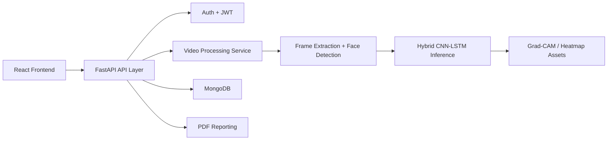

# AI-Based Deepfake Detection System Using Hybrid CNN-LSTM

A production-style full-stack deepfake detection platform built for academic submission, research prototyping, and portfolio showcase. The system combines a React analytics dashboard with a FastAPI backend and a Hybrid CNN-LSTM inference pipeline for classifying uploaded videos as `REAL` or `FAKE`.

## Highlights

- Full-stack architecture with React, Tailwind CSS, Framer Motion, FastAPI, and MongoDB
- JWT authentication with protected routes and role-aware admin endpoints
- Video processing pipeline with upload validation, ffmpeg compression, frame extraction, face detection, sequence generation, and inference
- Hybrid CNN-LSTM model architecture using EfficientNetB0 and Bidirectional LSTMs
- Evidence-aware reports that expose only outputs produced by the active model; the current temporal checkpoint emits a video-level score only
- Admin analytics, user history, report generation, Dockerized deployment, and cloud-ready structure

## Architecture



## Project Structure

```text
frontend/            React + Tailwind + Framer Motion dashboard
backend/             FastAPI API, services, ML modules, tests
datasets/            Dataset placeholders and generated manifests
scripts/             Training and preprocessing entry scripts
docs/                API, training, deployment documentation
nginx/               Reverse proxy configuration
docker-compose.yml   Multi-service local orchestration
```

## Backend Features

- `POST /auth/signup`, `POST /auth/login`
- `POST /upload-video`, `POST /predict`
- `GET /history`, `DELETE /history/{id}`
- `GET /report/{id}`
- `GET /admin/stats`

Security controls include password hashing, JWT auth, file validation, CORS configuration, and API rate limiting.

## ML Pipeline

### Inference Steps

1. Validate and decode the original uploaded video without lossy re-encoding
2. Sample frames using the training `FRAME_STRIDE` setting
3. Detect and crop faces, convert to RGB, resize to `224x224`, and scale to `[0, 1]`
4. Build the trained 20-frame sequence, repeating the last detected face when needed
5. Run the configured Keras checkpoint (`KERAS_MODEL_PATH`); ONNX remains an optional backend
6. Interpret the sigmoid output with the training labels (`0=REAL`, `1=FAKE`) and threshold `0.5`

The CNN-LSTM returns one video-level score. It does not provide frame-level
probabilities, audio outputs, or independent CNN/LSTM comparisons, so those
are not synthesized in the report. Missing or incompatible model files and
videos with no detected faces produce explicit errors instead of fallback
predictions.

### Training Design

- Transfer learning backbone: EfficientNetB0
- Temporal sequence model: stacked Bidirectional LSTMs
- Early stopping and checkpointing
- ReduceLROnPlateau scheduler
- TensorBoard logging
- Mixed precision enabled
- Optional ONNX export support via `tf2onnx`

## Datasets

Recommended datasets:

- FaceForensics++
- Celeb-DF
- DFDC

The CNN-LSTM training entrypoint consumes a labeled manifest with `0=real`,
`1=fake`, and `train`/`val`/`test` splits. For Celeb-DF v2, place the extracted
dataset in `datasets/Celeb-DF-v2/`, regenerate the manifest, then run:

```bash
python scripts/prepare_celebdf.py
python scripts/train_model.py --manifest datasets/celebdf_manifest.csv \
  --dataset-root datasets/Celeb-DF-v2 --epochs 20 --batch-size 2
```

Training uses the project face-crop pipeline, balances the real/fake loss,
keeps the held-out test split out of training and model selection, and writes
metrics to `backend/artifacts/evaluation/celebdf_test_metrics.json`. The
configured Keras checkpoint emits a thresholded Real/Deepfake model prediction
and keeps validation status separate. Its scores are not calibrated
probabilities. Current evaluation is near chance on a balanced sample of the
Celeb-DF v2 official test split; see
`backend/artifacts/evaluation/active_keras_test_sample.json` before interpreting
its outputs.

## Frontend Experience

- Futuristic cybersecurity-inspired landing page
- Auth flows for login and registration
- Dashboard with stats and detection timeline
- Upload page with drag-and-drop style interaction
- Results page with video-level model scores and explicit evidence limitations
- Analytics and history views
- Admin panel for high-level platform stats

## Quick Start

### 1. Configure environment

```bash
cp backend/.env.example backend/.env
cp frontend/.env.example frontend/.env
```

### 2. Run with Docker

```bash
docker compose up --build
```

### 3. Run locally without Docker

Backend:

```bash
cd backend
python3.11 -m venv .venv
source .venv/bin/activate
python -m pip install -r requirements.txt
python -m uvicorn app.main:app --reload
```

Use `python -m uvicorn` rather than the bare `uvicorn` command so the server
always starts with the active virtual environment's interpreter (important on
systems with multiple Python installations or shell command aliases).

The checked-in CNN-LSTM artifact was saved with Keras 3.x and is configured for
TensorFlow 2.20. Use Python 3.11 for the local backend environment; an existing
environment created with a different Python version must be recreated before
installing these requirements. The upload endpoint reports a specific setup
error when TensorFlow/Keras is missing or the checkpoint cannot be loaded.

Optional model export dependencies:

```bash
pip install -r requirements-export.txt
```

Frontend:

```bash
cd frontend
npm install
npm run dev
```

## Notes for Academic Submission

- Place the trained PyTorch checkpoint at `backend/artifacts/models/torch/best_checkpoint.pt` (or configure `TORCH_MODEL_PATH`). Mock inference is disabled by default.
- ONNX export tools are kept in `backend/requirements-export.txt` so the default app install stays compatible with TensorFlow on local development machines.
- Real-world production hardening should add malware scanning, asynchronous job queues, Redis-backed rate limiting, signed object storage URLs, and a proper Grad-CAM implementation against the trained model.

## Documentation

- [API documentation](docs/API.md)
- [Training guide](docs/TRAINING.md)
- [Deployment guide](docs/DEPLOYMENT.md)
- [Model notes](docs/MODEL_NOTES.md)
# proj
# proj
# proj
# proj
